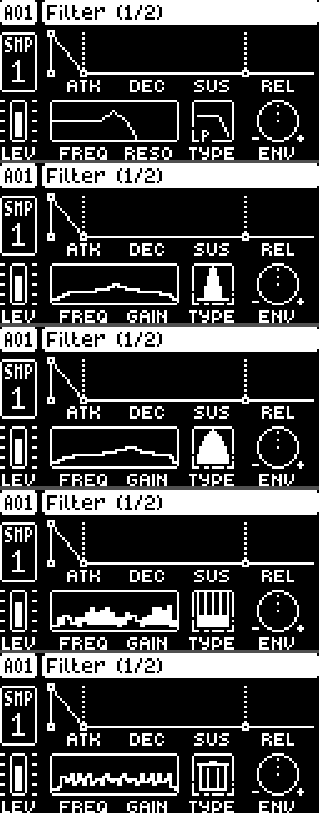
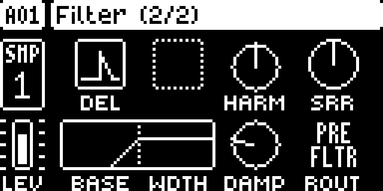

# DigiFilter

Extra per-track filter modes for the Elektron
Digitakt mk1 (OS 1.53).

A format-2 [elekloader](https://github.com/irpina/elekloader) mod, id
`digifilter`. It adds six filter types on top of the stock `OFF / LP / HP /
EQ:1..5`:

| TYPE | mode | what it is |
|---|---|---|
| 8 | **BP** | band pass (state-variable filter) |
| 9 | **BP2** | a wider band pass (about half the resonance) |
| 10 | **COMB** | feedback comb, delay from FREQ, feedback from RESO |
| 11 | **TRASH** | second comb at half the delay (a higher harmonic series) |
| 12 | **OB4** | the Oberheim OB-1's 4-pole lowpass ladder, self-oscillating at the top of RESO |
| 13 | **OB2** | the OB-1's 2-pole output: 12 dB/oct, resonating from the same 4-pole loop |

Each mode runs per track and uses that track's own FREQ, RESO and filter
envelope, exactly like the stock types. Stock TYPE values keep running the
stock filter — nothing here reimplements a stock mode.

The **FLTR page** redraws its FREQ/RES response curve for the new types (a
band-pass bell for BP/BP2, comb teeth for COMB, a trash can for TRASH) and shows
a small fixed version of each shape in the TYPE box to the right of the graph.
The screenshot shows the page for every type, top to bottom — LP (stock), BP,
BP2, COMB and TRASH:



**OB4** and **OB2** are modelled on the OB-1's VCF: a ladder of four OTA stages
with the resonance fed back from the fourth, saturating where the circuit does.
The FLTR page draws their lowpass response; top to bottom, LP (stock), OB4 and
OB2. How they were made and checked (SPICE, a model, the fixed-point kernel,
digiemu, a unit) is in [docs/ob1.md](docs/ob1.md).

Their FREQ control now follows the measured reference curve, from 10 Hz to
21 kHz with cubic travel. Resonance starts oscillating between RESO 80 and 81.
Existing OB4/OB2 Sounds therefore change at the same knob settings; their saved
format is unchanged. See the [calibration and its limits](docs/ob1.md#control-calibration).


> Digitakt **mk1 only**. Digitakt II's filter machines are out of scope.

## Status

The **audio path is done and validated** (BP / BP2 / COMB / TRASH and OB4 / OB2),
including the **filter envelope**, the **comb's own controls** (feedback on the
RESO/GAIN knob, Harmonics/Damping on the free C/G encoders), and the **FLTR
page's FREQ/RES response curve and TYPE-box glyphs**, which now redraw for the
new modes (a band-pass bell for BP/BP2, comb teeth for COMB/TRASH, a lowpass for
OB4/OB2). See [RE_NOTES.md](RE_NOTES.md).

Stress-tested on hardware over 3 days: **PASS** (a Digitakt mk1). **1.1a** was
tested on hardware (Digitakt mk1) on both **OS 1.53** and **OS 1.54**: PASS.

Everything in this repo builds (`BUILT`), lints against `core` and combines with
`digihealth` (`OK: the mods combine`).

## Known issues

- **BP (TYPE 8)** output is now **saturated to ±2^27** in the SVF (like the
  comb), so a high-Q peak on hot material clips cleanly instead of wrapping the
  32-bit sample. It is still a hard clip at the top of the range; back off
  RESO/ENV depth or use BP2 for very hot samples. (The resonance range is also
  capped at Q ~5.)

## Controls

- **FREQ (E)** sets the cutoff / comb pitch; **RESO / GAIN (F)** is the
  resonance, and for COMB/TRASH it is the comb **feedback** (0…127, up to 31/32
  for a metallic, near-self-oscillating ring); the
  **filter envelope (H + ADSR)** modulates the cutoff exactly as the stock types
  do.
- For **OB4/OB2**, **RESO / GAIN (F)** is the resonance: it self-oscillates from
  about 121, so the filter rings at FREQ even with no input.
- **Second FLTR page**, while TYPE is COMB or TRASH, adds **C = Harmonics**
  (delay divider 1–4) and **G = Damping** (a one-pole on the feedback), each
  shown as a round dial like the stock SRR knob. They sit **alongside** the
  stock **Base / Width / Env Delay / SRR** knobs, which keep working and saving
  normally — nothing is replaced. The two values are mirrored into saved kit
  words (best-effort persistence, since every sound slot is otherwise taken);
  their defaults (0) leave the plain comb.

  

## How it works

Three patch sites plus `ev_draw` / `ev_tick` subscriptions (addresses and the
full reverse-engineering are in [RE_NOTES.md](RE_NOTES.md)):

1. widen the Filter Type range field from max 7 to max 13;
2. re-point the TYPE label formatter so 8–13 print `BP / BP2 / COMB / TRASH / OB4 / OB2`;
3. hook the per-voice filter call in the render and run our own DSP for TYPE
   8–13, tail-calling the stock filter for everything else;
4. subscribe to core's `ev_draw` (`digifilter_draw`, order 40): after the page
   has drawn, when the shown page kind is FLTR (6) and the active track's TYPE
   is 8–13, mask the stock graph and TYPE box and paint the BP/BP2/COMB/TRASH/OB4/OB2
   response curve plus the mode's small TYPE-box glyph.
   (This composes with the event chain; patching the page drawView vtable entry
   `0x401842a0` directly lost the curve in multi-mod builds.)
5. on each UI tick, when the active track's TYPE is COMB/TRASH, put the comb's
   extra controls on the second FLTR page's free C/G encoders: commandeer two
   unused `Error` descriptors as filter descriptors on spare sound slots
   (`0x2f/0x30`), labelled `HARM`/`DAMP`. The comb feedback is the RESO/GAIN
   knob on page 1 (0…127). The stock Base/Width/Env Delay/SRR knobs are left
   untouched; the stock layout and descriptors are restored for any other TYPE.
6. in the same `ev_draw` handler, on page kind 7 (second FLTR page) for
   COMB/TRASH, paint a round dial (circle + needle, like SRR's) in each of the
   two free C/G cells — the commandeered descriptors give the label and input
   but no value widget, since their slot is past the model's range.

Our DSP is integer-only (no FPU, no libgcc): a trapezoidal state-variable
filter for BP/BP2, two feedback combs for COMB/TRASH, and a zero-delay-feedback
OTA ladder for OB4/OB2. The cutoff and resonance are smoothed (a coefficient ramp
across the block, and a fractional, smoothed comb delay) so modulating the filter
does not step or click. The filter envelope is added to the cutoff exactly as the
stock filter does.

Per voice per render block (measured in digiemu / `tests/df_bench.py`), TYPE 1
(stock) costs ~2400 instructions; **BP/BP2 ~1200 with static knobs and ~2400
while the cutoff is swept** (the coefficients are cached and only recomputed when
the cutoff/resonance actually move); COMB/TRASH ~1730; OB4/OB2 ~3000. So BP/BP2
are now cheaper than the stock filter when the knobs are still, and every mode
stays within the stock filter's own order. The SVF caches its coefficients, the
OB-1 ladder computes them at the block's ends and ramps between them, and the
comb's interpolation and feedback each use a single 32×32 multiply.

## Building

The usual development commands live in [`mise.toml`](mise.toml). Use
PowerShell on Windows and a shell on Linux/macOS; Windows tasks do not need
WSL or Bash.

### Setup

Install [mise](https://mise.jdx.dev/getting-started.html) and Git first.
Native build prerequisites depend on your OS:

| OS | prerequisites |
|---|---|
| macOS | Xcode Command Line Tools (`xcode-select --install`). Bootstrap installs the m68k toolchain through mise's Homebrew package support on Apple Silicon; Intel Macs need an existing m68k toolchain on PATH. |
| Linux | A native C/C++ toolchain, Make and `shasum` (Perl Digest::SHA). Bootstrap installs `build-essential` on Debian/Ubuntu and the m68k toolchain through mise's Homebrew package support. On other distributions install the native prerequisites with your package manager. |
| Windows | Visual Studio 2022 C++ Build Tools for the simulator's patched Unicorn, and native MinGW-w64 GCC for host DSP tests. Set `CC` to the native GCC executable if it is not named `gcc` on PATH. MSVC cannot compile the DSP's GNU C extensions. Mise installs the m68k compiler and binutils automatically. |

From a Git checkout:

```sh
mise trust
mise bootstrap
```

This installs Python 3.12, uv, CMake and GitHub CLI, fetches the pinned
`vendor/elekloader` and `vendor/digiemu` submodules, and builds digiemu's
patched Unicorn in its own Python environment. Bootstrap uses the upstream
PowerShell installer on Windows and shell installer on Unix. It is safe to
repeat: a compatible Unicorn is kept. Normal simulator/benchmark tasks use
that environment directly, without syncing over its patched library.

On Windows, mise downloads the [GCC 14.2.0 toolchain bundle](https://github.com/iratahack/m68k-elf-gcc/releases/tag/v14.2.0_latest),
verifies its pinned SHA-256 and adds its `m68k-elf-` compiler and binutils to
the task PATH. No manual cross-toolchain installation or PATH changes are needed.

Supply your own official `firmware/Digitakt_OS1.54.syx`. Builds default to
OS 1.54; set `DIGIFILTER_BUILD_OS=1.53` to build that OS or `all` for both,
supplying the matching stock files. Releases explicitly build both versions.
`check`, `firmware`, `emu` and `test:emu` depend on the build. Firmware and
generated outputs are ignored by Git.

GitHub Actions runs `mise run check`, `mise run test` and `mise run test:emu`
on macOS 26, Windows Server 2022 and Ubuntu 26.04. CI runs the full bootstrap
to install patched Unicorn, downloads stock OS 1.54 from Elektron and verifies
its SHA-256. A job after the matrix compares the generated firmware SHA-256
from all three runners and fails if any checksum is missing or different.
CI uses the same OS 1.54 default as local builds and keeps firmware and
generated files out of uploaded artifacts.

### Tasks

| command | result |
|---|---|
| `mise run build` | Build matching core and DigiFilter elemods for the selected OS under `out/os<OS>/` (default 1.54). |
| `mise run check` | Depend on `build`, then lint DigiFilter against its core and check that they combine. |
| `mise run test` | Run the workflow tests, floating-point models, native kernel, artefact and measured calibration checks. Calibration uses an isolated NumPy environment. |
| `mise run test:emu` | Build firmware, then check its cold boot and scripted runtime against stock firmware in the headless emulator. Write the report to `out/os<OS>/test-emu/report.json`. |
| `mise run bench` | Run the existing per-mode ColdFire instruction benchmark with patched Unicorn. |
| `mise run firmware` | Build core and DigiFilter for `ELEKLOADER_STOCK`, then write `out/os<OS>/Digitakt_custom.syx`. |
| `mise run emu` | Build that firmware, set it up in digiemu and open its panel. |
| `mise run release` | Build and test, require clean source pushed to `origin/master`, then publish both `.elemod` files on GitHub at the current commit with generated release notes. |

The simulator's task chain is `emu → firmware → build`: mise builds the
mods, patches the selected stock OS, then opens its panel.

`test:emu → firmware → build` uses the same selected stock OS and runs
digiemu's `emu.fwcheck` with boot, runtime and emulated audio-deadline checks
enabled. Run `mise bootstrap` first to install patched Unicorn. Each run
creates fresh test state under `out/os<OS>/test-emu/`, separate from saved
interactive simulator sessions. The report includes a stock comparison;
screen/audio differences are reported for inspection, not automatically
treated as failures. This task does not replace the focused DSP/UI tests.

The native tests and instruction benchmark do not establish firmware
integration, physical hardware behavior or real-time timing headroom.
The simulator stores each firmware build separately under `.digiemu/`;
old builds and their saved sessions are kept. The task accepts the custom
firmware through digiemu's `--add --yes` path. It never resets an existing
session. No task flashes hardware.

`firmware` and `emu` default to OS 1.54 and the four-character display
version `DFlt`. Set local preferences in ignored `mise.local.toml`:

```toml
[env]
DIGIFILTER_BUILD_OS = "1.53"
ELEKLOADER_STOCK = "firmware/Digitakt_OS1.53.syx"
FW_VERSION = "DFlt"
# Optional: a different compiler prefix or a full prefix path, without quotes inside the value.
# ELEKLOADER_CROSS = "C:/Cross Tools/m68k-elf/bin/m68k-elf-"
# CC = "C:/msys64/ucrt64/bin/gcc.exe"
```

Environment variables work too. For example, in PowerShell:

```powershell
$env:ELEKLOADER_STOCK = 'firmware/Digitakt_OS1.53.syx'
$env:DIGIFILTER_BUILD_OS = '1.53'
$env:FW_VERSION = 'DFlt'
mise run emu
```

For a release, authenticate `gh`, commit and push the changes to `origin/master`,
then run `mise run release`. Like OB-1, the task checks that the working tree
is clean and that HEAD has no commits ahead of `origin/master`. It uses gh's
default repository and publishes the two elemods with tag `v<mod.json version>`
and GitHub-generated notes. Version changes remain a separate release decision.

### Manual SDK build

The mod builds for **OS 1.53 and OS 1.54** from one source tree: `mod.json`
carries a `"ports": {"1.54": …}` block (the moved firmware addresses and the
site bytes, generated with `tools/port_os.py` from the DigiFilter ecosystem) and
the sources name each moved address through an `F_…`/`.LF_…` macro that resolves
per OS. The 1.53 build is byte-for-byte the same as before the port.

Needs the m68k cross toolchain, an elekloader checkout, a stock OS `.syx`, and
`core`. Set up the shell, then build (1.53 shown; use the 1.54 stock and a 1.54
`core` for the other):

```sh
export PATH="<m68k-elf bin>:$PATH"          # e.g. C:\SysGCC\m68k-elf\bin on Windows
export ELEKLOADER_CROSS=m68k-elf-
export PYTHONPATH="<elekloader checkout>"

python -m elekloader.sdk.build . --stock <Digitakt_OS1.53.syx>
python -m elekloader.lint  out/digifilter-1.1a.elemod --stock <Digitakt_OS1.53.syx> --with <core.elemod>
python -m elekloader.patch --stock <Digitakt_OS1.53.syx> --mod <core.elemod> --mod out/digifilter-1.1a.elemod --out custom.syx --version 2.0t --check
```

That must print `BUILT`, then `OK: links as core …`, then `OK: the mods
combine`. Drop `--check` on the last command to write `custom.syx`. Building
against the **OS 1.54** stock selects the port automatically (elekloader 0.5+;
it needs a stock file whose sha256 matches the release, so use the official
`Digitakt_OS1.54.syx`).

`core` is elekloader's `mods/core` (built, or its release). Add
`--with <digihealth.elemod>` / `--mod <digihealth.elemod>` if you use it — the
third site is chosen so this mod does **not** overlap digihealth 1.0.

## Files

| file | contents |
|---|---|
| `mod.json` | the mod: id, version, sites, sources, `requires core` |
| `filter.c` | modes, coefficients, the comb DSP, the site entry point |
| `filter_dsp.s` | the per-voice state-variable filter (ColdFire EMAC) |
| `filter_glue.s` | the raw site entry points (labels + the per-voice dispatcher) |
| `filter_ui.c` | the `ev_draw` handler (`digifilter_draw`: response curve, TYPE glyph, page-2 dials) and the page-2 `ev_tick` re-map (`digifilter_page2_sync`) |
| `filter_tables.h` | `g`, `k`, frequency and comb-delay tables |
| `ob1_vcf.c`, `ob1_vcf.h`, `ob1_tables.h` | OB4/OB2: the OB-1 ladder and its tables; its model, checks, SPICE circuit and digiemu tests are `tests/ob1_*`, `tests/spice/` and `tests/digiemu_filter_ob1_*` ([docs/ob1.md](docs/ob1.md)) |
| `tests/filter_model.py` | floating-point reference (`svf_block`, `comb_gain`) |
| `tests/df_bench.py`, `tests/df_bench.c` | per-voice instructions-per-block bench for every mode (Unicorn) |
| `tests/digiemu_filter_*.py` | headless digiemu traces/tests (need a digiemu checkout) |
| `tools/disas.py` | disassembly helper (`m68k-elf-objdump -m m68k:cfv4e`) |
| `tools/re_locate.py`, `tools/emu_filter.py` | early image/unicorn helpers |
| `RE_NOTES.md` | the reverse-engineering findings (and the 1.1a optimization ledger, §13) |
| `HANDOFF-OPTIMIZATION.md` | the 1.1a performance pass: what changed, how measured and verified |

## Testing

The OB4/OB2 [validation commands](docs/ob1.md#files) cover the native kernel,
measured calibration targets and focused ColdFire/firmware simulator checks.

```powershell
# floating-point model self-test (no toolchain needed)
python tests/filter_model.py

# per-voice cost bench (needs m68k-elf-gcc + digiemu's Unicorn):
python tests/df_bench.py

# live tests in digiemu (need a digiemu source checkout + a set-up firmware)
python tests/digiemu_filter_dsp.py  --digiemu <checkout> --fw <folder> --type 8
python tests/digiemu_filter_mod.py  --digiemu <checkout> --fw <folder> --type 10
python tests/digiemu_filter_cutoff.py --digiemu <checkout> --fw <folder>
python tests/digiemu_filter_curve.py --digiemu <checkout> --fw <folder>
python tests/digiemu_filter_page2.py --digiemu <checkout> --fw <folder>
```

## Releases

Prebuilt packages live in [`releases/`](releases/README.md) and on the
[GitHub Releases page](https://github.com/DigiAlchemydsp/DigiFilter/releases).
The current one, **`DigiFilter-1.1a.zip`**, carries **both OS builds** —
`elemods/digifilter-1.1a.elemod` for **OS 1.53** and
`elemods/digifilter-1.1a-os1.54.elemod` for **OS 1.54** — plus the sources,
docs and the install/build README. `releases/elemods/` also keeps the older
elemods (1.1, 1.0k, 1.0j, 1.0i, 1.0h).

## Credits

- **Digital Alchemy DSP** — the mod: the band-pass **BP / BP2** (state-variable),
  **COMB** and **TRASH** modes, the per-voice DSP and the FLTR-page response
  curve.
- **Simon Johansson** — the **OB4** and **OB2** modes: the Oberheim
  OB-1's VCF as a zero-delay-feedback ladder and its 2-pole output, from his
  SPICE study of the circuit (see [docs/ob1.md](docs/ob1.md)).

## Licence

GPL-2.0-or-later. No Elektron firmware is included or committed.
