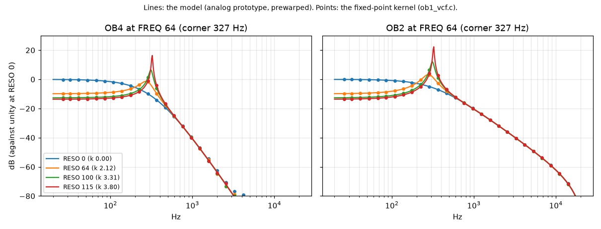
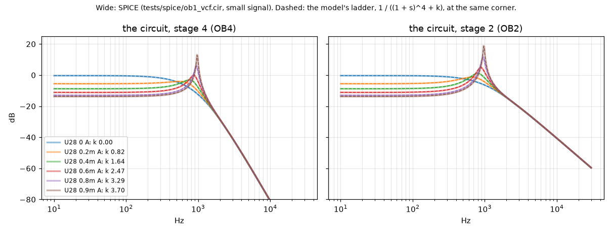
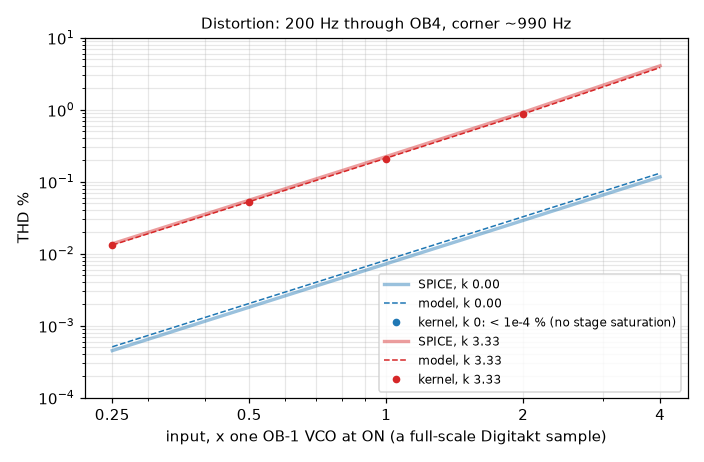
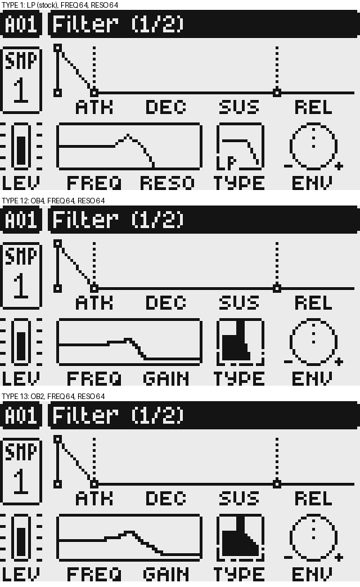

# OB4 and OB2: the Oberheim OB-1's filter

Two filter types, TYPE 12 and 13, modelled on the Oberheim OB-1's VCF: **OB4** is its 4-pole lowpass and
**OB2** its 2-pole output. On the OB-1 the 2-pole mode takes stage 2 while the resonance loop stays closed
from stage 4, so OB2 resonates and self-oscillates like OB4 but rolls off at 12 dB per octave. Both use the
track's FREQ, RESO and filter envelope as the other types do. This page is how they were made and checked;
the README has how to use them.

## The circuit

From the OB-1's synth board schematic (sheet 1342; the full reading:
https://github.com/simonjohansson/DigiFilter/issues/2): four CA3080 one-pole stages, alternating
non-inverting and inverting, so stage 4 follows the input; a fifth 3080 (U28) feeds stage 4 back to the
input as negative feedback, the ladder's resonance; the MODE switch takes the output from stage 2 or 4.
Cutoff is 1 V/oct through an exponential converter; resonance is linear in its control voltage, and the
OB-1 self-oscillates (a trimmer sets where). The stages run at ~1/455 of the signal, so the filter is
clean until there is resonance: then U28 saturates.

## Control calibration

The [reference measurements](reference-filter-mapping.md) calibrate the two controls while retaining
the four stages, fourth-stage feedback, output taps, saturation, output scaling and coefficient ramp.
For normalized cutoff `u` and resonance `r` (each knob divided by 127), the calibration is:

```text
cutoff = 10 + 20990 u^3 Hz
q = 10 r^2
k = q                           when q <= 4
k = 4.25 - 0.375 / (q - 2.5)    when q > 4
```

The cubic cutoff follows the measured display law. The quadratic resonance below onset follows the
measured bass loss, placing oscillation at about 63.25% travel: integer RESO 80 decays and 81 grows.
Above onset, the compressed drive fits the measured rise in relative oscillation amplitude while
keeping the maximum feedback at approximately 4.2 and retaining the existing saturation/headroom.
This upper branch is an empirical calibration, not an inferred reference implementation. At nominal
1 kHz its relative oscillation levels at RESO 83, 87 and 95 agree within 0.4 dB after level matching.
The response display uses the same calibration on its logarithmic frequency axis.

The measured cutoff attenuation is reproduced at 250 Hz, 1 kHz and 4 kHz: approximately 12 dB for OB4
and 6 dB for OB2, relative to their zero-resonance passbands. Exact resonant pitch and motion remain
different. In the measured 0.49-to-0.51 full-resonance jump, this filter moves from about 2,480 to
2,794 Hz, compared with the reference's 2,541 to 2,876 Hz. The same 10 ms pitch-analysis window gives
about 6 ms settling here versus 18 ms in the reference; neither is an isolated smoothing constant.
The existing coefficient ramp remains shared with envelope and fractional cutoff modulation.
Matching those residual differences would require further calibration beyond these control laws.

Existing OB4/OB2 patches change sound at the same knob settings. Parameter storage and the other
filter types are unchanged. This calibration is against a software reference, not a physical OB-1.

## How it was checked

1. **SPICE** (`tests/spice/`, ngspice): the stages as tanh transconductors into 300 pF, the dividers and
   U28's loop. It confirmed the reading (a 4-pole cascade, 24 dB/oct, the passband falling as 1/(1 + k)),
   gave the loop gain (k ~ 4.15 per mA of U28's bias, self-oscillation at ~0.96 mA, independent of the
   cutoff), and showed where the circuit distorts.
2. **The model** (`tests/ob1_model.py`): a zero-delay-feedback ladder of trapezoidal one-poles with U28's
   tanh in the feedback and each stage's OTA tanh. Its linear response is exactly the analog prototype's
   bilinear transform; its distortion matches SPICE's within 1.3 dB without resonance and 0.5 dB at k 3.3.
3. **The kernel** (`ob1_vcf.c`): Q31 fixed point with ColdFire EMAC multiplies, U28's saturation as tanh's
   series to the fifth power, the coefficients ramped across each block, and a -102 dB seed near
   self-oscillation so it starts from silence. Checked against the model on the host (`tests/ob1_check.py`,
   `tests/ob1_artefacts.py`).
4. **The firmware** (digiemu, core 4.0 + DigiFilter, OS 1.53; `tests/digiemu_filter_ob1_*.py`): the
   kernel in the firmware against its host build, TYPE 13 chosen with the encoder through the render, the
   FLTR page, saving and reloading a project, copying a track's Sound, and a stock 1.53 loading such a
   project.
5. **A unit** (Digitakt mk1, OS 1.53), with the elektrob-1 OB-1 machine as the source.

Items 4 and 5 describe the original implementation checks. The current control calibration was
checked with native renders, linked ColdFire execution and freshly built firmware on **both OS 1.53
and 1.54**. The focused firmware fixture exercises both taps, fractional cutoff, envelope contribution,
voice state and eight active voices through the actual filter dispatch. It does not repeat encoder,
save/reload or physical-unit checks.

## Figures

`tests/ob1_plots.py` draws the first three (cc, matplotlib; ngspice for the SPICE ones). The FLTR page is
from digiemu. These images illustrate the original calibration; their knob positions and response
display have not been regenerated for the current control laws.









## Results

| | |
|---|---|
| model | the linear ladder matches the analog prototype; 24 / 12 dB per octave; passband 0.25 / (1 + k); self-oscillation from k = 4; distortion within 1.3 dB of SPICE (no resonance) and 0.5 dB (k 3.33) |
| saturation | with resonance in U28, the resonance OTA (knee 1.61 x a VCO at stage 4); without, only the stages' own OTAs, and slightly (knee 4.9). The kernel has U28's |
| kernel vs model | linear: worst error 7.6e-4 of the peak over 72 cases spanning FREQ 0-127, RESO 0-78 and both outputs; resonant distortion within 0.03 dB at 0.5-2 x a VCO, k 3.30 |
| level | the render's blocks are Q31; a full-scale sample is two OB-1 VCOs at ON (`IN_SHIFT`), so a hot mix saturates as two would. The output saturates rather than wraps |
| full-scale input and sweeps | no wrap-around at low cutoff; a full-scale sweep FREQ 20-90-20 at RESO 73 steps no more than a gliding model (0.1414 against 0.1410) |
| cutoff sweep | one FREQ step a block: within 6.0e-4 of a sample-by-sample glide |
| self-oscillation | from silence at RESO 127: about 8.9 s at FREQ 0 (10 Hz), 0.36 s at 32, 0.11 s at 48, 0.05 s at 64, 0.02 s at 96/112; the quiet seed is enabled from RESO 80 |
| artefacts | silence in gives exactly silence out through RESO 79; after a loud note the tested tails settle within 176 LSB (-142 dB) of zero; stable at every corner of the knobs; tested folded harmonics at least 144 dB under the fundamental |
| headroom | paired native sweeps peak at 0.351 full scale, versus 0.358 before calibration; full-scale square/alternating stress inputs remain below clipping, peaking at 0.886 |
| cost | 3044-3053 (OB4) and 2980-2989 (OB2) instructions per block; at RESO 64 through the dispatch 3093 / 3028 |
| ColdFire agreement | linked kernel differs from native by at most 7098 Q31 LSB in moving-control, onset, full-scale, clamp and voice-state cases (less than a quarter of a 16-bit output step) |
| in the firmware | both OS builds match native output within 16 Q31 LSB through the actual dispatch, including fractional cutoff and envelope depth |
| audio timing | eight active voices, moving cutoff, maximum resonance: no missed render deadlines, worst remaining timing margin 28.46% (OS 1.53), 28.32% (OS 1.54) in the focused simulator fixture |
| FLTR page (original calibration) | OB4/OB2 draw their response (by RESO) and a lowpass glyph in the TYPE box (`tests/digiemu_filter_ob1_curve.py`) |
| real UI path (original calibration) | TYPE stepped to 13 with the encoder, through the render, FREQ 80, RESO 64, 1500 Hz: 0.07654 against the model's 0.07653 (`tests/digiemu_filter_ob1_real.py`) |
| save / reload (original implementation) | TYPE 12 and 13 saved to the +Drive, rebuilt from the card, loaded back: unchanged (`tests/digiemu_filter_ob1_persist.py`); stock 1.53 loads and plays such a project |
| copy / paste (original implementation) | a track's Sound with TYPE 12 or 13 copied to another track: unchanged (`tests/digiemu_filter_ob1_copy.py`) |

## Limits and checks not repeated

- Physical listening and FLTR encoder/display interaction have not been repeated after calibration.
- Fresh builds, core 4.0 lint and patch verification passed for both OS versions. GCC 16 required the
  existing pointer-conversion warning to be nonfatal for these local validation builds; source build
  policy was not changed.
- The firmware checker accepted each candidate after stock comparison, with no new strict violations.
  Both overall reports pass; stock firmware itself fails the strict baseline on a null-address read
  during boot, and the same candidate read is marked as present in stock. The focused runtime fixtures
  report no strict violations.
- Not checked: a Sound with TYPE 12/13 exported to the +Drive and imported back. Sounds are saved by the same serializer as projects (RE_NOTES §8), which the project save/reload exercises.

## Files

| file | what |
|---|---|
| `ob1_vcf.c`, `ob1_vcf.h` | the kernel |
| `ob1_tables.h` | the ladder's G per FREQ index, logarithmic graph positions and response curves; generated |
| `tests/ob1_model.py` | the floating-point reference and its self-test; `--table` writes `ob1_tables.h` |
| `tests/ob1_check.py` | the kernel (host build) against the model |
| `tests/ob1_artefacts.py` | the kernel's digital artefacts: silence, stability, aliasing |
| `tests/ob1_calibration.py` | actual native cutoff, bass loss, oscillation onset and relative oscillation levels |
| `tests/ob1_coldfire.py` | linked ColdFire versus native output, clamps and voice state |
| `tests/digiemu_filter_ob1_calibration.py` | both firmware taps, envelope/fractional cutoff and eight-voice timing |
| `tests/ob1_bench.c`, `tests/ob1_bench.py` | the kernel's ColdFire cost per block, in Unicorn |
| `tests/ob1_plots.py` | the figures |
| `tests/spice/` | the circuit (ngspice): `ob1_ac.cir` the responses against the resonance, `ob1_thd.cir` the distortion |
| `tests/digiemu_filter_ob1_*.py` | the firmware in digiemu: curve, real UI path, save/reload, copy/paste |

From the repository's root:

```sh
mise exec python@3.12.13 -- python tests/ob1_model.py
mise exec python@3.12.13 -- python tests/ob1_model.py --table > ob1_tables.h
mise exec python@3.12.13 -- python tests/ob1_check.py  # needs cc
mise exec python@3.12.13 -- python tests/ob1_artefacts.py
mise exec python@3.12.13 -- uv run --with numpy python tests/ob1_calibration.py
# the cost needs a Unicorn that runs EMAC (digiemu's patched build), from a digiemu checkout:
mise exec python@3.12.13 -- uv run --with numpy python <DigiFilter>/tests/ob1_bench.py
mise exec python@3.12.13 -- uv run --with numpy python <DigiFilter>/tests/ob1_coldfire.py
# from this repository, using that same patched-Unicorn environment and a fresh fwcheck build folder:
mise exec python@3.12.13 -- python tests/digiemu_filter_ob1_calibration.py \
  --digiemu <checkout> --fw <build-folder> --os 1.53  # or 1.54
```
